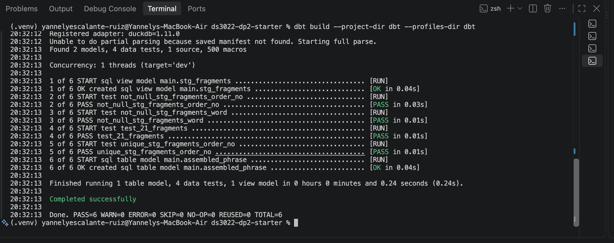
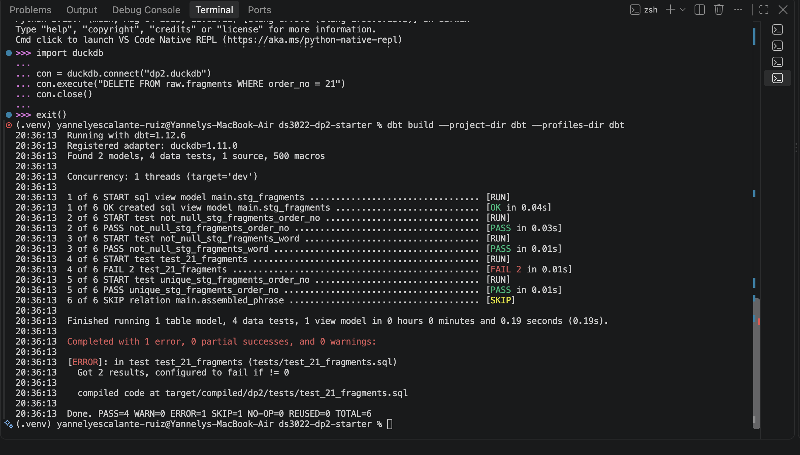
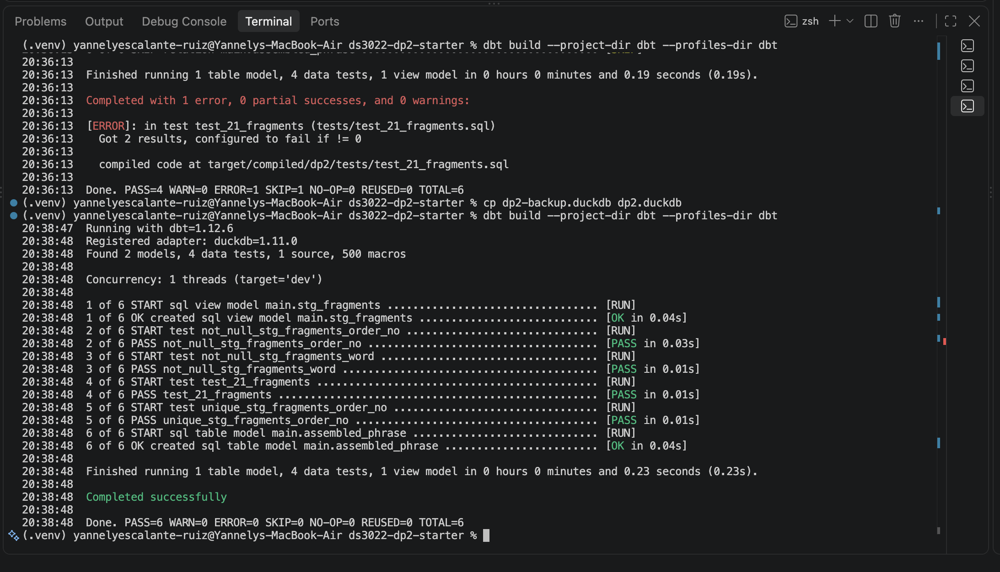
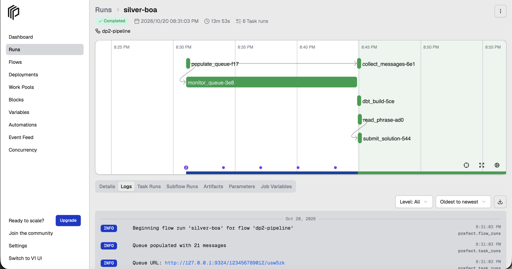
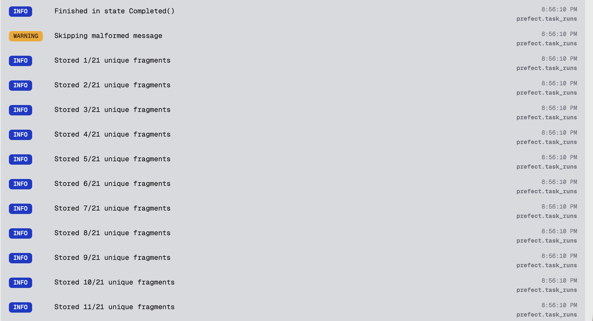
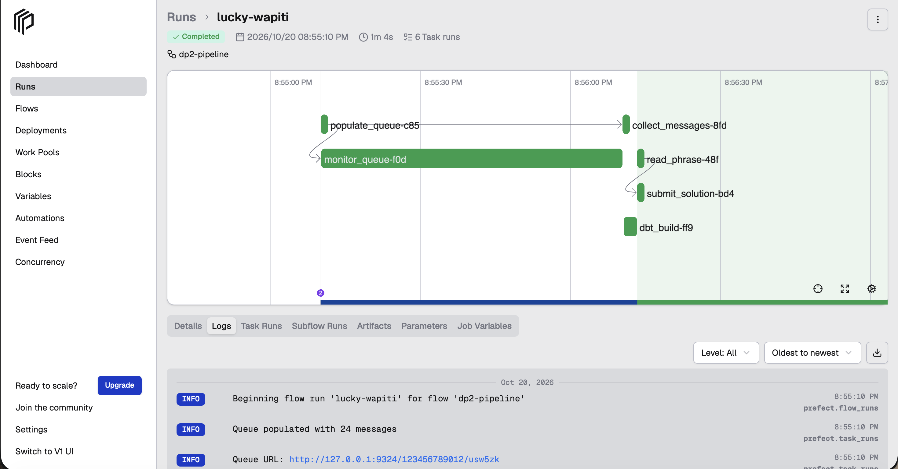
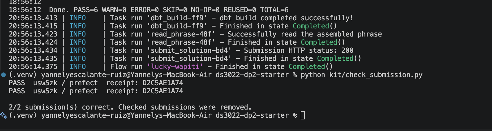
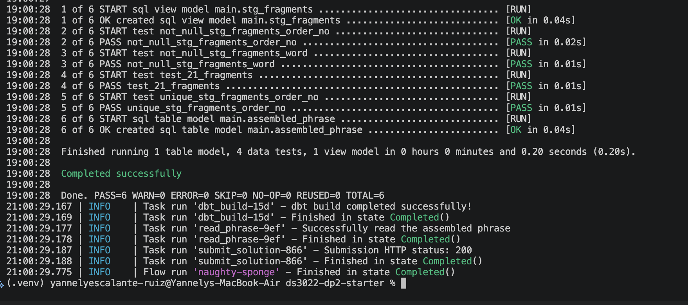
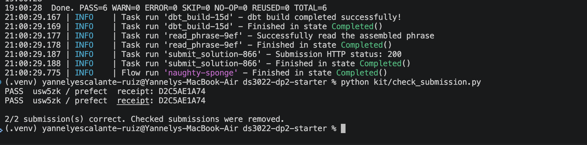

# DS 3022 Data Project 2: The SQS Puzzle

## Project Overview

For this project, I built a data pipeline using Prefect, Amazon SQS (through a local Moto emulator), DuckDB and dbt. The goal was to collect 21 message fragments, arrange them in the correct order and submit the completed phrase.

The pipeline runs automatically, from creating the SQS queue to submitting the final phrase. I also tested the pipeline under normal delays and chaos mode to make sure it could handle unexpected messages.

## Technologies Used

- **Python and Prefect:** Workflow orchestration and task logging
- **Moto and boto3:** Local SQS emulator and message processing
- **DuckDB:** Storage for collected message fragments
- **dbt:** Data cleaning, quality tests and phrase assembly
- **Git and GitHub:** Version control

## Setup and Running the Pipeline

I used four terminals in VS Code.

First, I created and activated the Python virtual environment and installed the project dependencies following `SETUP.md`.

I configured `.env` with my UVA computing ID and the local SQS emulator settings.

The terminals run the following commands:

**Terminal 1: Prefect server**

```bash
prefect server start
```

**Terminal 2: Moto SQS emulator**

```bash
moto_server -p 9324
```

**Terminal 3: Scatter API**

```bash
python kit/scatter_api.py
```

**Terminal 4: Pipeline**

```bash
python prefect-flow.py
```

Before running the pipeline, I can verify the local services with:

```bash
python kit/smoke_test.py
```

The pipeline can be monitored through the Prefect dashboard at `http://127.0.0.1:4200`.

For faster testing, I used `DP2_FAST=1`. For the required full-delay evidence run, I restarted the Scatter API with `DP2_FAST=0`.

## Pipeline Design

My Prefect pipeline follows six main tasks:

1. **populate_queue:** Sends a POST request to the Scatter API to generate the messages.
2. **monitor_queue:** Checks the queue until all delayed messages become available.
3. **collect_messages:** Receives, validates and stores the fragments in DuckDB before deleting their SQS messages.
4. **dbt_build:** Runs the dbt models and quality tests.
5. **read_phrase:** Retrieves the assembled phrase from DuckDB.
6. **submit_solution:** Sends the completed phrase to the `dp2-submit` queue.

The pipeline diagram is saved in `docs/dag.jpg`.

## Polling Strategy

I used a polling strategy because SQS messages do not all become available at the same time.

The `monitor_queue` task checks three queue counters: visible, not visible and delayed. It waits until the delayed count reaches zero before moving to message collection.

The `collect_messages` task uses SQS long polling with `WaitTimeSeconds=20` and `MessageAttributeNames=["All"]`. It handles empty responses using `.get("Messages", [])` and continues until the expected unique fragments have been collected and the queue is empty.

I chose this approach because it avoids constantly requesting messages when none are available. It also allows the pipeline to handle different message arrival times without manually checking the queue.

A timeout prevents the pipeline from waiting indefinitely if the expected fragments never arrive.

## DuckDB Storage and dbt Quality Gate

The pipeline stores fragments in `raw.fragments` in DuckDB. Each fragment has an order number and a word.

The dbt staging model, `stg_fragments.sql`, converts order numbers to integers, cleans the words and removes exact duplicates.

I created generic tests to check for missing values and duplicate order numbers. I also created a singular test that requires exactly 21 fragments with order numbers from 1 through 21.

The `assembled_phrase.sql` model combines the words using their order numbers.

I tested the quality gate by intentionally introducing errors:

- **Missing fragment:** I removed a row, causing the 21-fragment test to fail.
- **Conflicting duplicate:** I inserted another word with an existing order number, causing the uniqueness test to fail.

In both cases, dbt reported errors and skipped the final phrase model. After restoring the original data, all tests passed again.

The Prefect `dbt_build` task raises an error if dbt fails, preventing the pipeline from submitting an invalid phrase.

### Quality Gate Evidence

**Passing dbt tests:**



**Failing dbt test after removing a fragment:**



**Failing dbt test after inserting a conflicting duplicate:**



## Full-Delay Evidence Run

I completed the required full-delay run with `DP2_FAST=0` and `DP2_CHAOS=0`.

The Scatter API used normal message delays of 30–900 seconds.

My Prefect flow, `silver-boa`, completed successfully in approximately 13 minutes and 53 seconds.

The dbt build passed all six operations with zero errors, and the submission returned HTTP status 200.

I verified the result using:

```bash
python kit/check_submission.py
```

The submission passed verification.



## Chaos Round

For the chaos round, I enabled `DP2_CHAOS=1` and `DP2_FAST=1`.

Chaos mode introduces 24 messages: 21 valid fragments, two duplicate messages and one malformed message missing a required attribute.

### What Broke and Why

My original `collect_messages` function assumed that every received message contained valid `order_no` and `word` attributes. A malformed message could cause the function to fail when accessing an attribute that was missing.

The original function also counted received messages rather than unique fragments. This could cause duplicates to be counted toward the expected 21 fragments.

### How I Fixed It

I updated `collect_messages` to validate message attributes before inserting them into DuckDB.

The function now:

- Skips malformed messages and logs a warning.
- Tracks previously collected order numbers to avoid counting duplicates.
- Stores valid fragments before deleting their messages.
- Continues processing until all 21 unique fragments are collected and the queue counters reach zero.
- Raises an error if the expected fragments are not collected before the timeout.

### Chaos Test Results

I completed two consecutive chaos-mode runs without changing the configuration between them.

| Run | Prefect Flow | dbt | Submission |
|---|---|---|---|
| 1 | `lucky-wapiti` | PASS=6, ERROR=0 | PASS |
| 2 | `naughty-sponge` | PASS=6, ERROR=0 | PASS |

Both runs completed successfully and returned HTTP status 200. The submission checker confirmed the correct phrase in both runs.

**Chaos handling evidence:**



**Chaos Run 1:**





**Chaos Run 2:**





## Submission Verification

My completed pipeline successfully submitted the assembled phrase to the local `dp2-submit` queue.

- **UVA computing ID:** usw5zk
- **Platform:** prefect
- **HTTP status:** 200
- **Verification result:** PASS
- **Receipt code:** `D2C5AE1A74`

The receipt was verified using `python kit/check_submission.py`.

## Conclusion

This project helped me understand how to build a data pipeline that handles delayed and unexpected messages while checking data quality before submission.

The most important improvement was making the collection task more reliable. By validating messages, avoiding duplicate fragments and checking that the queue was empty, I was able to complete the normal and chaos-mode runs successfully.